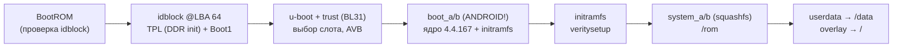

# Прошивки

Стоковая прошивка Capsula - Linux на aarch64: подписанные
boot/vbmeta/system (squashfs, dm-verity) и неподписанный пользовательский
`userdata`.

- [OTA-пакеты](ota.md) - откуда берётся сток, что внутри, чем полезен
  сообществу.
- [Джейлбрейк](jailbreak.md) - userspace-метод получения root без
  изменения подписанных разделов.

## Цепочка загрузки

Путь по шагам (заводская прошивка Capsule-14):

1. **BootROM** проверяет подпись idblock (RSA-ключ из eFuse) и читает
   idblock @ LBA 64.
2. **TPL** (`rk3308_ddr_589MHz_uart2_m1_v2.11`) инициализирует DDR и
   возвращает управление BootROM; **Boot1** (miniloader; заводские
   сборки v1.14 - ранние платы, v1.33 - поздние, она же в OTA 44.90)
   поднимает SFTL и грузит разделы. Boot1 верифицирует trust per-сборкой:
   чужой trust → `LoadTrust err:-3` → глухой MaskROM - поэтому пара
   «uboot+trust» непереносима между платами с разными сборками Boot1.
3. **u-boot + trust (BL31)** выбирают слот (AVB) и грузят
   `boot_a|boot_b`, формируя cmdline `androidboot.slot_suffix=_a|_b`.
4. **boot** - формат `ANDROID!` (page 2048): ядро **4.4.167** +
   initramfs (busybox) + resource.img (DTB).
5. **initramfs** парсит слот, монтирует `system_a|_b` через
   `veritysetup` (dm-verity поверх squashfs: данные 0..35 МиБ, дерево
   35..43 МиБ, `--hash-offset=36700160`) и делает `switch_root`.
6. **Система**: `/rom` - squashfs (ro), `/data` - userdata (ext2),
   rw-слой - overlayfs `upperdir=/data/overlay/upper` поверх `/`
   (этим механизмом пользуется userspace-джейлбрейк).

## Верифицированная загрузка (AVB)

- vbmeta_a/b - формат AVB0 (Android Verified Boot 1.1); из OTA:
  vbmeta_a подписан SHA256_RSA4096 (+AVB ATX metadata),
  vbmeta_b - SHA512_RSA4096.
- boot каждого слота верифицируется против vbmeta этого слота
  (cmdline получает `androidboot.slot_suffix`); заголовки vbmeta
  читаются из публичных OTA-пакетов.

## Известные версии (заводские, Capsule-14)

| Компонент | Версия |
|---|---|
| TPL (DDR init) | `rk3308_ddr_589MHz_uart2_m1_v2.11` |
| Boot1 (miniloader) | v1.14 (2019-04-19, ранние платы) / v1.33 (2021-10-28, поздние; в OTA 44.90) |
| u-boot | сборка 2020-07-23 |
| Ядро | Linux 4.4.167 |
| system | squashfs xz 128K |

TODO: changelog версий прошивок (известная точка - 44.90, в ней из
rootfs удалён `adbd`), детали A/B-обновления по OTA.
